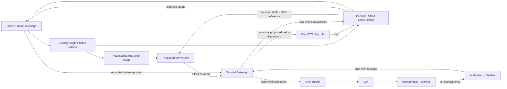

# Alfred Development V1 — minimum working build plan

Status: planning artifact only, 2026-10-14. No production change, Gateway filing,
agent execution, GitHub operation or Photon intake was performed for this plan.

## Locked product scope

One owner, one company (`alfred`), one disposable repository (`dev-001`), one
central Gateway CTO, one Builder, one QA and one independent Reviewer. A natural
language Photon request can create only a Gateway-validated `proposed` task.
The CTO plans; the owner then approves the exact task and execution scope through
the Gateway's existing human, hash-bound controls. A separately authorized
publisher may create a draft PR after QA and review. Merge and deployment stay
human actions. Personal Alfred reports status and the PR, never grants authority.

No mandatory command syntax, second Photon connection, Kanban task authority,
new company, specialist roster, message-history reconciliation or automatic
merge/deployment is in this build.

## Inventory, verified by read-only inspection

| Component | Classification | Evidence and practical limit |
| --- | --- | --- |
| Personal Alfred + Photon sidecar/adapter | WORKING | Installed default profile has Photon enabled and the sidecar's `app.messages` loop forwards inbound messages. Ordinary messaging was not live-tested in this review. |
| Natural-language development intake | MISSING | No installed intake plugin; staged `alfred_development_intake-0.3.2` is not deployed and writes Kanban triage tasks directly, so it cannot be installed unchanged for this mission. |
| Protected owner-event provenance | BLOCKED BY EXISTING AUTHORIZATION | Installed adapter uses `sender.id` then `space.phone`/`space.id`; the current sidecar control token and Photon credentials share the Hermes trust domain. A protected event/turn claim and an approved process boundary are needed before owner-only filing. The staged v0.3.2 turn-context patch is reusable as a test/input, not proof of OS isolation. |
| Gateway envelope, registry binding, dispatcher and manual `run-once` | WORKING | `alfred.devreq/1`, protected `hermes` inbox binding, registry resolution, idempotent journal and proposed-task filer exist on `main`. Real `run-once` is held by the task-ID safety decision. |
| Gateway task-ID allocation for real filing | BLOCKED BY EXISTING AUTHORIZATION | `taskspec.next_id` uses max+1 from the checked-out `.dev/tasks` alone. Proposed ADR 0011 records the owner's decision not to run real `run-once` before this is made safe. |
| `dev-001` laboratory repository | EXISTS BUT NOT INTEGRATED | Local Git repository has no remote and no `.dev/tasks`; a separate disposable Gateway fixture is needed. The real registry has no `dev-001` mapping. |
| Central CTO | EXISTS BUT NOT INTEGRATED | Gateway role registry has one `ALFRED-DEV-CTO` read-only plan role, but the headless workflow is fake-only. Hermes `developmentcto` profile has delegation and Kanban tools and must not become a second task authority. |
| Builder, QA, independent Reviewer | EXISTS BUT NOT INTEGRATED | Interactive `/ship` agents and Gateway role definitions exist. Headless stages have only fake runners; no separately accepted Phase B containment or Phase C real run. |
| Kanban | WORKING | Hermes Kanban exists; it may display or acknowledge a filed task later, but cannot create the canonical task or issue an execution grant. |
| Evidence Bridge v0.2.1 + read-only status tools | WORKING | Installed `alfred_development_status` plugin is version 0.2.1; preserve its files and toolset. The T-0017 Photon status adapter is read-only and its outbox data lacks certified provenance; `project_report` returns `None`. |
| Publisher and GitHub PR | EXISTS BUT NOT INTEGRATED | Gateway verifies publishable evidence and has draft-PR templates, but its real client, credential source and real runner are absent; current CLI refuses. Existing interactive `/ship` is human-operated, not this automated flow. |

## Minimum integration

The protected claim must be derived from the current authenticated SDK event,
never from model arguments, text, chat ID or the adapter's address fallback. It
need only bind explicit sender, provider message ID, conversation, event text
digest, expiry and one request ID to the single `alfred`/`dev-001` scope. It
does not need native reply targets, a second connection, catch-up history or
guaranteed provider replay. Missing identity, delivery uncertainty, duplicate
conflict or changed draft fails closed with a fresh resend request. The SDK's
redelivery guarantee remains unverified.

## Dependency-ordered stages

| Stage | Reuse | Minimum new work and authority | Tests and completion |
| --- | --- | --- | --- |
| V1.1 Photon → Gateway → CTO plan | Existing sidecar connection, v0.3.2 classifier/turn-context ideas, Gateway envelope/dispatcher, Gateway CTO plan schema | Adopt a narrow ADR 0003 Phase 4 amendment and an ADR 0009 compliant Hermes/Photon boundary; implement a protected SDK-event claim and one proposed-only writer, safe task-ID allocation, static `dev-001` lab registry and a Gateway-filed event to a plan-only CTO runner. Authorize automatic trusted Gateway pickup separately; Hermes never invokes `run-once`. | Synthetic owner/other sender, missing sender, fallback, forged model/IPC, replay, duplicate, cross-company and uncertain-delivery refusals; lab Gateway creates exactly one `proposed` spec and CTO returns a bounded plan with no worker or Kanban dispatch. OS isolation and one live Photon trial require separate approval. |
| V1.2 Approved Builder | Gateway approval, spec hash, PAUSE/STOP, T-0007 supervision, Gateway role registry | Complete ADR 0008 Phase B containment and separately approve Phase C real runner for one scoped `dev-001` task. CTO plan is data; trusted Gateway rechecks approval and scope before Builder. | Invalid/expired/revoked approvals, scope drift, protected paths, credential reach, escaped processes and stopped runs denied; one approved Builder changes only the disposable worktree. |
| V1.3 QA + independent review | Existing QA/Reviewer roles, artifacts, evidence checks | Wire real isolated role sessions and trusted verdict capture; one QA, one independent Reviewer, no self-review. | QA tests mapped to acceptance criteria; failing QA or Reviewer blocks publication; verdict binds the exact candidate commit and scope. |
| V1.4 Draft GitHub PR | Gateway publisher verifier, branch/PR templates | Separately approve a single-repository, short-lived publisher credential or a human publisher. Add real GitHub client, idempotent draft-PR recording and retry reconciliation. Keep credential outside Hermes and role sessions. | Only reviewed candidate can be committed to a task branch, pushed and opened as a draft PR; denied or stale evidence cannot publish; merge/deploy methods absent. Use a separately approved disposable remote for `dev-001`. |
| V1.5 Full Photon acceptance | Existing conversation and read-only status tools | Return Gateway-certified task/workflow/PR status through Personal Alfred; preserve Evidence Bridge. Do not promote writable outbox text to authority. | Owner sends a natural-language lab request, receives Gateway task ID and CTO plan, approves by trusted channel, observes Builder→QA→Reviewer→draft PR, receives PR URL/commit/checks through Photon; production conversation and Evidence Bridge still work. Human merges or declines. |

## Role handoff contract

| From → to | Bounded input | Required output | Enforcement |
| --- | --- | --- | --- |
| Gateway → CTO | Filed task ID, canonical spec hash, sanitized `dev-001` repository context | Objective, requirements, affected project, one Builder assignment, tests, risks, questions and steps | Plan-only read tools; no Gateway transition, grant, delegation or shell. |
| CTO → Builder | Owner-approved task/hash, plan, permitted paths, budget | Changed-file list, commit/candidate digest, tests and failures | Gateway rechecks approval, scope and containment. |
| Builder → QA | Candidate snapshot and criteria, without Builder authority | Test evidence and PASS/FAIL per criterion | Separate session; QA cannot approve or publish. |
| QA → Reviewer | Same immutable candidate, QA evidence and criteria | Independent verdict with findings and covered commit | Separate session; no self-review; trusted code checks evidence. |
| Reviewer → publisher | Verified candidate, approvals and bound verdict | Draft PR URL, commit, check status | Publisher re-derives authority and has only the scoped credential. |

## Full acceptance scenario

After each stage's separate authorization, the owner texts a plain-language
`dev-001` change request to Personal Alfred. A missing/forged sender does not
file. The authorized message produces exactly one Gateway `proposed` task, even
if the submission retries. One CTO produces the structured plan. The owner
approves the exact task/hash through the trusted Gateway approval route;
unapproved execution is denied. One Builder changes a permitted file in the
disposable repository. QA runs relevant tests, a separate Reviewer verifies the
same commit, and the publisher opens one draft PR on a disposable remote.
Personal Alfred reports the canonical task ID, stage, PR URL, commit and checks
to the same owner through the unchanged Photon connection. No merge, deploy,
real-company repository access, cross-company disclosure or second Photon
connection occurs. Failed/uncertain Photon delivery asks for resubmission and
never invents a filed or approved status.

## Next task and approvals

**Next engineering task to authorize: V1.1a Gateway task-ID safety gate.** In
staging, prepare a reviewed protected-source patch for `taskspec.next_id` and
`IntakeFiler.file_envelope` so Gateway allocation cannot reuse a reserved ID,
an ID on an unmerged branch or an ID concurrently claimed by another filing.
Test allocation and idempotent `run-once` only with an isolated `dev-001` fixture,
including collision, retry and interruption cases. Deliver the exact diff and
rollback; do not run the real dispatcher. Once accepted, V1.1b adds the narrow
protected owner-event claim and proposed-only envelope writer using the current
Photon connection. Preserve the schema and static requester binding. Do not
deploy the staged Kanban intake plugin as a substitute.

Human decisions before live V1.1: accept the specific ADR 0003 Phase 4
natural-language requester scope; approve an ADR 0009 compliant whole-process
boundary or exact exception with OS evidence; approve the task-ID allocator
change and automatic trusted Gateway pickup; approve the `dev-001` fixture,
source diff, operator installation and live Photon acceptance. V1.2 requires
separate ADR 0008 Phase B and C authorizations plus a task-specific hash-bound
approval. V1.4 requires separate publisher credential and GitHub publication
authorization. This plan grants none of them.

Deferred: native threaded-reply confirmation, full Photon replay/reconciliation,
additional developers or specialists, security-reviewer expansion, multi-company
onboarding, autonomous approvals, real repositories, automatic merge and deploy.

## Source anchors

- Personal Alfred and Hermes CTO instructions: `~/.hermes/SOUL.md` and
  `~/.hermes/profiles/developmentcto/SOUL.md`; CTO profile toolsets in its
  `config.yaml`.
- Installed Photon event normalization and adapter fallback:
  `~/.hermes/hermes-agent/plugins/platforms/photon/sidecar/index.mjs:642-715` and
  `adapter.py:818-854`.
- Gateway authority: `docs/adr/0003-development-gateway.md`,
  `docs/adr/0008-automated-development-workflow.md`,
  `docs/adr/0009-hermes-requester.md`, proposed
  `docs/adr/0011-development-v1-organization.md:24,39`,
  `.dev/bin/taskspec.py:182-184`, `.dev/bin/intake.py:133-155`,
  `src/alfred/gateway/requesters.py:28-33`.
- T-0017 limit: `docs/photon-intake.md:1-55`; Gateway role and publication
  state: `.dev/security/roles/roles.json`, `docs/gateway.md:760-765,889-910`.
- Staged intake mismatch: `milestone2/release/dist/alfred_development_intake-0.3.2/ARCHITECTURE.md:4-12`.
