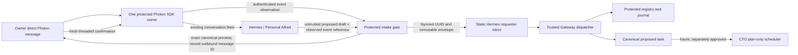

# Milestone 2 Option B — natural-language Development intake

**Status:** staging design for human review, 2026-10-14. No implementation,
authoritative ADR amendment, task approval, service change or Gateway filing
is authorized by this document. This revised package lives under Task A because
the earlier `milestone2/proposals/` drafts and immutable v0.1.2/v0.1.3 archives
are historical evidence and are left unchanged.

## Decision and compatibility limit

Keep the existing single Spectrum/Photon connection and Hermes' ordinary
conversation path. Add only a protected observation of original inbound SDK
events and a protected confirmation/submission gate. Personal Alfred may use
the existing model turn to recognize a development request, gather details and
propose a bounded draft. Its proposal is **untrusted data**. The gate alone
checks original event provenance, renders the exact proposed scope to the
owner, validates a fresh owner confirmation and publishes a canonical
`alfred.devreq/1` envelope. No generic Hermes `/submit(handle, ...)` route is
an authorization path. Ordinary Photon messages and replies remain ordinary
conversation; this design does not attempt to prove the generating model turn
of every general-purpose reply.

This is conditional on running the event-observing sidecar under a protected
identity without exposing its control token or Photon credentials to Hermes.
The installed adapter currently holds the sidecar token and credentials
(`plugins/platforms/photon/adapter.py:569-575,641-642,1044-1048` relative to
`/home/alfred/.hermes/hermes-agent`), and the sidecar token currently reaches
`/send-attachment` with an arbitrary path and `/shutdown`
(`plugins/platforms/photon/sidecar/index.mjs:1024-1067,1100-1119`). A protected
event tap on the same UID/token as Hermes is forgeable. The smallest safe
integration must split protected observation/control from a reviewed,
compatibility-preserving messaging interface. If that split cannot pass live
compatibility and whole-process OS tests, **stop**; do not weaken confirmation
to an Hermes-supplied sender, handle, session ID or model assertion.

## Functional workflow

The gate obtains the original event only from its protected SDK-side feed. It
checks explicit `sender.id`, project/account, inbound direction, direct-message
conversation, native message ID, freshness, content type and forwarding/quote
flags. It rejects missing identity, address fallback, bot/internal/delegated
events and unsupported metadata. A bounded owner event record includes native
message ID, sender digest, conversation ID, exact original text, timestamp and
content digest. Hermes receives only a reference to that already recorded
event; it cannot create or amend one.

The proposed draft must cite one live owner request event and may include
bounded later owner clarification events from the same conversation. The gate
compares the cited original text with its own record, fixes the lab/company
scope from protected configuration, checks the existing envelope schema and
forbids workflow/authority fields. Classification and drafting may use the
existing Personal Alfred turn, but neither classification nor draft content
proves authorization. If the original text is not clearly a development ask,
the owner still sees the verbatim text in the preview and must explicitly
confirm; the gate does not claim to independently understand its semantics.
The gate caps active proposals per owner/conversation and globally, enforces
preview rate limits and expiry, and audits denials with privacy-safe codes so
a compromised Hermes process cannot flood the owner with challenges.

## Conversation and confirmation state machine

| State | Entry and permitted transition | Owner-visible meaning |
| --- | --- | --- |
| Normal conversation | Existing Hermes chat; a model-identified request may propose a draft tied to a protected event reference. | No Development task exists. |
| Development request identified | Gate verifies the referenced original owner event and reserves it against conflicting drafts. Invalid or stale references are rejected. | Alfred may gather details. |
| Development request drafted | Canonical bounded envelope candidate and digest are stored durably. Any changed scope, source event set, project hint or material field creates a **new version**. | Alfred can explain the proposal; no submission yet. |
| Awaiting authenticated confirmation | Protected gate sends a complete, canonical preview of the material draft and verbatim source request. It persists the preview digest, version, outbound Photon message ID, owner/conversation and expiry. | “Reply to this preview if it is right.” |
| Confirmed | A new, direct owner SDK event is a **threaded reply** whose native reply target equals that one stored preview message ID; same sender/account/conversation; accepted affirmative text; still-live exact draft digest/version; no prior consumption. The confirmation event itself is durably recorded before transition. | Permission to submit this exact draft once. |
| Submitted | Gate fsyncs one UUID, immutable `alfred.devreq/1` bytes and ledger state, then atomically publishes to the static bound inbox. Retries reuse UUID and bytes. | Locally submitted, not yet Gateway-filed. |
| Gateway received | Trusted Gateway journal records `received` for UUID/revision. | Gateway has begun validation. |
| Gateway filed | Gateway journal and canonical spec agree on `filed`, task ID, protected registry project, `source: hermes`, `status: proposed` and `approved_by: null`. | Canonical task exists; no execution approval. |
| Needs clarification | Gateway requests clarification or owner materially changes scope. A fresh authenticated owner answer is attached, a new draft version/preview is issued, and a new confirmation is required. Gateway revision increases only under its existing rule. | Further owner input is needed. |
| Rejected | Invalid provenance, conflict, owner denial or Gateway rejection is recorded with a bounded reason. | No task from this attempt. |
| Uncertain or expired | Provider/sidecar gap, lost preview acknowledgment, failed fsync, unknown send result, stale confirmation or expired draft. Hold publication and ask for a fresh authenticated resend or new preview confirmation. | Do not imply the request was filed. |

The confirmation grammar is deliberately small and deterministic: for example,
case-folded `yes`, `yes, go ahead`, `please proceed`, and `confirm`, after
whitespace/punctuation normalization. A model cannot classify a free-form
reply as authorization. Negative or mixed intent (`yes, but change ...`) is
not an affirmative; it returns to drafting. The preview is capped so all
material fields can be shown, including objective, scope, constraints,
acceptance criteria, project and the original owner's words. An oversized
draft must be shortened and re-previewed. The owner need not type a command or
code: they use Photon's ordinary threaded-reply gesture and natural words.

**Exact binding:** `(protected account, original owner ID, conversation ID,
original event ID, draft version, canonical envelope digest, preview outbound
message ID, fresh confirmation event ID)` is one ledger transition. A bare
“yes”, the newest chat handle, a quoted copy of the preview, a model assertion,
or an adapter-inferred reply target cannot select a pending draft. Several
pending previews may coexist only when native reply targets uniquely identify
one; missing/duplicate/conflicting target, identity mismatch, expired preview,
changed draft, cancellation and replay all fail closed. The gate asks for a
fresh preview and threaded confirmation. It never silently chooses the most
recent task.

The installed lower-level Photon message type carries `replyTargetGuid` and
`threadOriginatorGuid` (`@photon-ai/advanced-imessage/dist/groups-CMgks3Ll.d.ts:442-449`),
Spectrum maps those to a reply target
(`@spectrum-ts/imessage/dist/index.js:1173-1209`), and the current sidecar
normalizes `targetMessageId` (`sidecar/index.mjs:575-590`). **Source support
is not live reliability proof.** A reviewed integration must prove the native
`replyTargetGuid` is stable for the deployed account, points to the gate's
actual sent preview, and survives delay/reconnect. The gate must read the raw
provider field; Spectrum's fallback from `replyTargetGuid` to
`threadOriginatorGuid`, a hydrated/stub target or Hermes' sent-message cache
cannot silently count as direct-preview evidence. The confirmation must be a
distinct inbound event observed after the challenge was armed; outbound echoes
are ignored. If these properties cannot be proved, natural-language “yes”
cannot be safely bound under this design; deeper upstream work or a new human
architecture decision is required.

The **current** `app.messages`/sidecar normalization does not say whether its
`targetMessageId` came from `replyTargetGuid` or the SDK's
`threadOriginatorGuid` fallback. It therefore cannot by itself meet the
authorization rule. A reviewed upstream API or sidecar integration must expose
the original direct-target field within the single protected connection;
until then this is an implementation blocker, not a permissible fallback.

## Failure and recovery policy

- Detected receive interruption, cursor rejection, restart gap, local spool
  failure or missing original event: mark affected work uncertain; request a
  fresh authenticated resend. No V1 full-history replay or perfect recovery
  claim. A silent provider loss can remain undetected.
- Preview send failure or unknown outbound message ID: do not arm a challenge.
  A later apparent reply cannot confirm it. Reissue a new preview if safe.
- Confirmation fsync failure: no submission; ask for a fresh threaded reply
  after recovery. A duplicate confirmed event with the same immutable digest
  is idempotent; a conflicting duplicate is rejected.
- Inbox publication outcome uncertain: reconcile the **same UUID and exact
  bytes** with the protected broker ledger and Gateway journal before retry.
  Never create a new UUID solely because a receipt was lost. A new owner resend
  may still be a semantically duplicate *new* request; surface that possibility
  for owner/operator resolution rather than claiming global exactly-once.
- Gateway status is taken from its protected journal and canonical spec. The
  requester-writable outbox is a display projection, never authorization.
  Missing or contradictory evidence means unavailable, not `filed`.

## Token and authority budget

Use the existing Personal Alfred model turn for intent and drafting; no second
LLM verifies identity, consent, status or permissions. A small deterministic
state machine checks event IDs, sender, conversation, reply target, version,
digest, expiry and dedup. The Gateway's existing deterministic schema,
registry, requester binding and journal checks remain authoritative. Store
bounded records and privacy-safe audit codes; do not log raw principal IDs,
message contents, credentials or full drafts in general service logs.

## Supersession and next human decisions

This supersedes the **command-based** Option B proposal (`/dev request` and
`/dev confirm` were mandatory there) and the broad staging broker plan that
required handle-bound general replies and provider catch-up before intake.
The v0.1.2/v0.1.3 releases and their independent security findings remain
historical evidence, unchanged. Their unresolved sidecar control-route and
OS-boundary findings remain applicable where this design crosses those paths.
See the proposed ADRs, Task A spec, topology, planning handoff and approval
checklist in this directory. A human must decide the protected sidecar split,
natural-language threaded-confirmation criterion, Linux exception and exact
protected paths before implementation is authorized.
